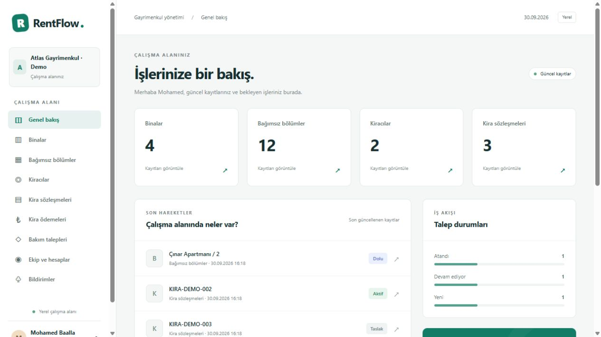

# RentFlow

A Laravel application for managing rental properties, lease agreements, monthly payments and maintenance requests. Each company has its own workspace, with separate access for managers, accountants, technicians and tenants.

The interface is in Turkish. Setup and technical documentation are in English, with an [Arabic usage guide](README-AR.txt).

## What it does

- Manage buildings, rental units and tenant records.
- Draft and activate leases with an inclusive date-overlap check for the same unit.
- Generate monthly payment schedules, including short-month and contract-boundary handling.
- Record collections and prevent duplicate payment confirmation.
- End leases while retaining paid installments and historical debt.
- Route maintenance requests through review, technician assignment, work and completion.
- Provide a tenant portal restricted to that tenant's leases, payments and maintenance.
- Store private before/after photos, internal notes, audit history and in-app notifications.
- Search, filter and export authorized records to CSV.

## Try the main workflow

~~~text
Building → Unit → Tenant → Draft lease → Activate lease → Monthly payments
                                                        ↓
Tenant maintenance request → Manager review → Assigned technician → Completion
~~~

1. Sign in as the demo administrator and open **Kira sözleşmeleri**.
2. Create a lease for an available unit, then select **Sözleşmeyi etkinleştir**.
3. Open its generated payments and record a collection as an administrator or accountant.
4. Sign in as the tenant, create a maintenance request, then use the manager and technician accounts to progress it.
5. Sign in as the second-company administrator to see a separate workspace.

## Engineering decisions

| Concern | Implementation |
| --- | --- |
| Company boundaries | Company-scoped queries and ownership filters on reads and writes |
| Lease conflicts | Inclusive interval overlap check before activation |
| Atomic changes | Activation, payment generation and state changes use database transactions |
| Money | Amounts stored as integer cents; full monthly rent, without daily prorating |
| Payment dates | Day 31 clamps to the last day of short months and the contract boundary |
| History | Paid installments and past debt survive lease termination |
| Uploads | Images stored outside the public directory and served through authorized routes |
| Duplicate actions | State checks and unique database constraints |

## Run locally

Requirements: PHP 8.2+, Composer 2, and the PHP extensions PDO SQLite, sqlite3, mbstring, fileinfo, DOM/XML, GD and OpenSSL. No Node.js build, MySQL server or external service is required for this version.

~~~sh
git clone https://github.com/mohammedbaalla/RentFlow.git
cd RentFlow
composer install --no-dev --prefer-dist --no-interaction
php scripts/setup.php
php artisan serve --host=127.0.0.1 --port=8021
~~~

Open **http://127.0.0.1:8021**.

Setup creates the local environment file, application key, SQLite database, tables and sample records. It writes a randomly generated demo password and the account list to **DEMO-ACCOUNTS.txt** on your machine. That file is intentionally excluded from Git. Re-running setup preserves existing demo records and credentials.

On Windows, **setup.cmd**, **start.cmd** and **test.cmd** provide equivalent shortcuts. If you prefer an empty workspace, create a company through the registration page.

### Demo roles

| Account | Access |
| --- | --- |
| admin@rentflow.test | Company administration and account management |
| manager@rentflow.test | Operational records and assignments |
| accountant@rentflow.test | Leases and rent collections |
| technician@rentflow.test | Assigned work |
| tenant@rentflow.test | Own records through the client portal |
| other-admin@rentflow.test | A separate company for isolation checks |

Use the generated password in DEMO-ACCOUNTS.txt. Do not publish it or reuse demo credentials for a public deployment.

### Daily maintenance

~~~sh
php artisan workspace:daily
~~~

Updates overdue payments and expired leases, then adds in-app reminders. To run the scheduled task at 08:00 in the configured Europe/Istanbul timezone, keep **php artisan schedule:work** running during local development.

### Local data

- Database: **database/database.sqlite**
- Private images: **storage/app/private/photos**
- Environment: **.env**
- Generated credentials: **DEMO-ACCOUNTS.txt**

These runtime files are excluded from the repository. A backup of a working installation should include its environment file, database and uploaded images.

## Tests

~~~sh
composer test
~~~

The integration suite currently performs **99 checks** using an isolated SQLite database in memory and temporary upload storage. It exercises HTTP routes and rendered pages, company isolation, tenant ownership, CRUD, lease overlap rejection, payment dates, duplicate payments, maintenance transitions, private images and internal-note visibility. It does not reset your application database.

GitHub Actions runs setup and the same suite on PHP 8.2.

## Code map

| File or directory | Responsibility |
| --- | --- |
| [RentFlowService.php](app/Services/RentFlowService.php) | Lease, payment and maintenance business rules |
| [RecordPolicy.php](app/Policies/RecordPolicy.php) | Role and record access |
| [RecordRequest.php](app/Http/Requests/RecordRequest.php) | Validated form input and allowed relationships |
| [ResourceController.php](app/Http/Controllers/ResourceController.php) | Resource lists, forms and record operations |
| [WorkspaceController.php](app/Http/Controllers/WorkspaceController.php) | Dashboard, notifications, photos and CSV |
| [resources.php](config/resources.php) | Resource fields, labels and list columns |
| [migrations](database/migrations) | Tables, relationships and database constraints |
| [views](resources/views) | Blade templates |
| [verify.php](tests/verify.php) | Isolated integration verification |

## Scope and next steps

This is a runnable local portfolio project with fictional demo data. Collections are recorded manually; there is no bank or payment-provider integration. Notifications are in-app. Rent is charged as a full amount for every covered calendar month. MySQL migration, email delivery and password-reset email are not verified or implemented features of this version.

Possible extensions: prorated rent, financial reporting, email reminders and a tested MySQL deployment.

Related project: [FixFlow](https://github.com/mohammedbaalla/FixFlow), a technical service workflow application.

## License

MIT. Laravel and other dependencies retain their respective licenses.
